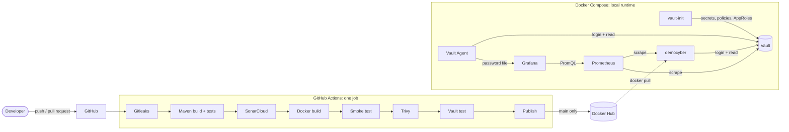

# Democyber Vault 🔐

> DevSecOps mini-project: the full TP1 → TP4 chain, plus one signature.
> **No secret in Git, in the image or in the Compose file. Every runtime secret lives in HashiCorp Vault.**

[](https://github.com/Saifeddin0Nairi/devSecOps-Vault/actions/workflows/ci.yml)
[](https://sonarcloud.io/summary/new_code?id=Saifeddin0Nairi_devSecOps-Vault)

| | |
|---|---|
| **Author** | Saif Eddin Nairi, 5th year Cybersecurity Engineering, EPI Digital School (Sousse) |
| **Course** | DevSecOps, Mme Amara Balkis, 2026–2027 |
| **Built on** | my TP repository [`tp-devsecops`](https://github.com/Saifeddin0Nairi/tp-devsecops) (TP1 to TP4) |

---

## 1. The idea

In TP1 to TP4, I built a pipeline for the Spring Boot app `democyber`. Each TP also showed a weakness. This project does two things:

1. **Base**: it fixes every weakness found in my TP work (see [section 4](#4-what-changed-compared-to-the-tps)).
2. **Signature**: it adds **HashiCorp Vault**. The app and Grafana get their secrets from Vault at startup. Vault generates the values itself, and they are never written in the repository.

> *Gitleaks finds secrets in the code. Vault is where secrets should live.*

## 2. Tools: one row per TP

| TP | Tools | Role in this project |
|---|---|---|
| TP1 | Git, Maven, Docker, Docker Hub, GitHub Actions | version, build, test, package, publish |
| TP2 | Gitleaks, Trivy | block leaked secrets, block vulnerable images |
| TP3 | SonarCloud | code analysis and Quality Gate |
| TP4 | Actuator, Prometheus, Grafana | metrics and dashboards |
| ⭐ Bonus | HashiCorp Vault (KV v2, AppRole, Vault Agent, audit log) | stores and delivers every runtime secret |

## 3. Architecture



- **CI side**: the pipeline secrets (Docker Hub and SonarCloud tokens) stay in GitHub Secrets.
- **Runtime side**: the app secrets (API key, Grafana admin password) come from Vault.

## 4. What changed compared to the TPs

| Found in | Weakness | Fix in this project |
|---|---|---|
| TP2 pipeline | The smoke test could never fail (`curl … \|\| echo`) | Real smoke test with retries. It fails the job |
| TP2 pipeline | A pull request could publish `latest` to Docker Hub | Publish only on a push to `main` |
| TP2 pipeline | Only the `latest` tag | Tags `:<commit-sha>` and `:latest` |
| TP1 to TP3 | Default token permissions | Least-privilege `permissions:` |
| TP3 (SonarCloud) | The container ran as root (Security rating B) | Non-root user |
| TP1 | No tests | Web tests run in CI |
| TP1 | Java 17 in `pom.xml`, Java 21 in CI and in the image | Java 21 everywhere |
| TP4 report | Grafana `admin/admin` | Password generated and delivered by Vault |
| TP4 report | Images on `latest` | Pinned versions |
| TP4 report | Ports open on `0.0.0.0` | Bound to `127.0.0.1` |
| TP4 report | Actuator on the public port | Separate management port `8081`, not published |
| TP2 report | "Store secrets in a vault, e.g. HashiCorp Vault" | Done |

## 5. CI/CD pipeline

One job, like in the TPs: [`.github/workflows/ci.yml`](.github/workflows/ci.yml). It runs on every push and pull request to `main`.

| # | Step | Tool | Blocks the pipeline when… | Evidence |
|---|---|---|---|---|
| 1 | Secret scan | Gitleaks | a secret is found in the history | `gitleaks-report` artifact (SARIF) |
| 2 | Build + tests | Maven | the code does not compile or a test fails | test results in the log |
| 3 | Code analysis | SonarCloud | the Quality Gate fails | SonarCloud dashboard |
| 4 | Image build | Docker | the build fails | image `democyber-vault:ci-<sha>` |
| 5 | Smoke test | curl | health is not UP, `/` is not 200, `/api/secure` without a key is not 401, or Actuator answers on the public port | job log |
| 6 | Image scan | Trivy | a HIGH or CRITICAL vulnerability is found | `trivy-report` artifact (JSON) |
| 7 | Vault integration test | Docker Compose + Vault | the app does not get its secret, or still starts when Vault denies access | job log |
| 8 | Publish | Docker Hub | (runs only on a push to `main`) | `saifeddinenairi/democyber-vault:<sha>` and `:latest` |

Rules:

- Pull requests run steps 1 to 7 and never publish.
- The image tested in steps 5 to 7 is the exact image that is published.
- Third-party actions are pinned by commit SHA.
- Commits follow the TP convention: `feat:`, `fix:`, `test:`, `chore:`, `docs:`.

## 6. Vault: the signature

### 6.1 Vault in one minute

| Word | Meaning here |
|---|---|
| **Vault** | A safe for secrets, with access rules and an audit log |
| **KV v2** | A key/value secrets engine with versions: `secret/democyber`, `secret/grafana` |
| **Policy** | What a client may read. Each client can read one path only, read-only |
| **AppRole** | Login for machines: `role-id` is like a username, `secret-id` is like a password |
| **Token** | What a client receives after login. It has a short life (TTL) |
| **Vault Agent** | A helper that logs in and writes a secret to a file, for apps that don't talk to Vault (Grafana) |
| **Audit log** | One line per request: who, when, which path. Secret values are hashed |
| **Dev mode** | In-memory Vault, already unsealed, with a root token. For demos only |

### 6.2 Who reads what

| Client | Login | Can read | How it receives the secret |
|---|---|---|---|
| `democyber` | AppRole `democyber` | `secret/data/democyber` | Spring Cloud Vault at startup. No access means no start (fail closed) |
| Grafana | AppRole `grafana`, through Vault Agent | `secret/data/grafana` | Vault Agent writes a file, read with `GF_SECURITY_ADMIN_PASSWORD__FILE` |
| Prometheus | token with the `metrics` policy | `sys/metrics` | bearer token file |
| Admin (me) | root token from `.env`, dev mode only | everything | `vault` CLI and web UI |

`vault-init` is a one-shot container. At each start it creates the secrets (random values generated by Vault), the policies, the AppRoles and the audit log. Then it gives each client its login through a private volume that only this client can read. It runs as root with one Linux capability only (`CHOWN`), so that each login file belongs to the user of its client. The app gets its two login files through a 3-line wrapper in `compose.yml`, which passes them to the Java process only.

### 6.3 Where the secrets are not

- **Not in Git**: Gitleaks is green.
- **Not in the image**: `.dockerignore` sends only the JAR to the build.
- **Not in `compose.yml` or `docker inspect`**: containers receive file paths, not values.
- **Not in the logs**: the app, `vault-init` and Vault Agent never print a secret value. Only Vault itself, in dev mode, prints its own root token when it starts (see [section 12](#12-limits-and-next-steps)).
- `.env` holds one value only, the Vault dev root token. It is git-ignored (see the limits in [section 12](#12-limits-and-next-steps)).

### 6.4 Honest limit: "secret zero"

The app still needs one credential to log in to Vault: its AppRole `secret-id`. Here the trusted `vault-init` container delivers it through a private volume. In production, this is solved with a platform identity (Kubernetes auth, cloud IAM) or with a wrapped, single-use `secret-id`.

## 7. Quick start (Windows PowerShell)

Requirements: Docker Desktop (running), JDK 21, Git.

```powershell
git clone https://github.com/Saifeddin0Nairi/devSecOps-Vault.git
cd devSecOps-Vault

# 1. Local config: only the Vault dev root token, with a random value
Copy-Item .env.example .env
(Get-Content .env) -replace 'change-me', ([guid]::NewGuid().ToString()) | Set-Content .env

# 2. Build the JAR, then start everything
.\mvnw.cmd -B clean package
docker compose up -d --build --wait
docker compose ps -a     # all services healthy, vault-init "Exited (0)"
```

| Service | URL |
|---|---|
| App | http://localhost:8080 |
| Vault UI | http://localhost:8200 (token: the value in `.env`) |
| Prometheus | http://localhost:9090 |
| Grafana | http://localhost:3001 (user `admin`, password from Vault, see below) |

Read the Grafana password as admin. Never put a secret value in a screenshot.

```powershell
docker compose exec -T vault vault kv get -field=admin-password secret/grafana
```

Stop with `docker compose down`. Vault runs in dev mode (in memory), so the next start creates new secrets. `docker compose down -v` also deletes the volumes (audit log, bootstrap files).

## 8. Demo scenarios

Each demo follows the TP method: it works, then I break it, the control blocks it, then I fix it.

### Demo 1: the secret comes from Vault

```powershell
$key = docker compose exec -T vault vault kv get -field=api-key secret/democyber
curl.exe -i http://localhost:8080/api/secure                          # 401: no key
curl.exe -i -H "X-API-Key: wrong" http://localhost:8080/api/secure     # 401: wrong key
curl.exe -i -H "X-API-Key: $key" http://localhost:8080/api/secure      # 200: key from Vault
```

In Grafana, the Vault password works and `admin/admin` is refused.

### Demo 2: least privilege (no access, no start)

```powershell
docker compose exec -T vault vault policy write democyber /vault/policies/democyber-deny.hcl
docker compose restart democyber
docker compose logs --tail 20 democyber    # "permission denied": the app stops
```

In Prometheus (Status → Targets), `democyber` is **DOWN**. Then restore the policy:

```powershell
docker compose exec -T vault vault policy write democyber /vault/policies/democyber.hcl
docker compose restart democyber           # healthy again
```

### Demo 3: rotation

```powershell
docker compose exec -T vault sh -c 'vault kv put secret/democyber api-key=$(vault write -field=random_bytes sys/tools/random/32 format=hex)'
docker compose restart democyber
docker compose exec -T vault vault kv metadata get secret/democyber    # current_version is now 2
```

The old key now gets 401. The new key (read it again with Demo 1) gets 200.

### Demo 4: audit trail

```powershell
docker compose exec -T vault sh -c 'tail -n 3 /vault/logs/audit.log'
```

Each line shows who asked (AppRole `democyber`), when, and which path. Secret values appear only as HMAC hashes.

### Demo 5: Gitleaks catches a Vault token

On a throwaway branch, I commit a fake Vault token (`hvs.…`) and open a pull request. Gitleaks fails the pipeline. Then I close the pull request without merging and delete the branch, so `main` stays clean.

## 9. Monitoring

- Prometheus scrapes `democyber:8081/actuator/prometheus` every 5 seconds, Vault's `/v1/sys/metrics` (with its own token), and itself.
- Grafana is provisioned as code (data source and dashboards), so there are no manual clicks:
  - **Spring Boot** (dashboard ID 11378): JVM memory, CPU, HTTP traffic
  - **Democyber Security**: app and Vault status, 401 vs 200 answers on `/api/secure`, Vault request rate
- Grafana has no data volume on purpose: at each start it reads the current admin password from Vault.
- Grafana downloads no plugin at startup (`GF_PLUGINS_PREINSTALL_DISABLED`): it runs only the code of its pinned image.

## 10. Project structure

```text
devSecOps-Vault/
├── .github/workflows/ci.yml       # the CI/CD pipeline
├── src/main/...                   # Spring Boot app: /, /api/secure, Actuator
├── src/test/...                   # web tests
├── vault/
│   ├── init/vault-init.sh         # bootstrap: secrets, policies, AppRoles, audit log
│   ├── policies/                  # democyber, grafana, metrics, democyber-deny (demo)
│   └── agent/                     # Vault Agent config and template for Grafana
├── monitoring/
│   ├── prometheus.yml
│   └── grafana/                   # provisioning and dashboards as code
├── scripts/
│   ├── smoke-test.sh
│   └── test-vault-integration.sh
├── Dockerfile                     # non-root runtime image
├── compose.yml                    # vault, vault-init, democyber, vault-agent, prometheus, grafana
├── .env.example                   # VAULT_DEV_ROOT_TOKEN_ID only
├── .gitattributes, .gitignore, .dockerignore
├── mvnw, mvnw.cmd, .mvn/          # Maven Wrapper
└── README.md
```

## 11. Evidence for the report

- [ ] Green pipeline run on `main`, all steps visible
- [ ] Gitleaks and Trivy artifacts
- [ ] SonarCloud Quality Gate passed
- [ ] Docker Hub: tags `<sha>` and `latest`
- [ ] Pull request run: the publish steps are skipped
- [ ] Red pull request run: Gitleaks catches the fake Vault token
- [ ] `docker compose ps -a`: all services healthy, ports on `127.0.0.1`
- [ ] Vault UI: secrets engine, policies, AppRole auth method, audit device
- [ ] Demos 1 to 4 in the terminal, with no secret value visible
- [ ] Prometheus targets all UP, then `democyber` DOWN during Demo 2
- [ ] Grafana: Spring Boot and Democyber Security dashboards

## 12. Limits and next steps

- **Dev mode** keeps data in memory, and anyone who controls Docker on this laptop can see the root token (in `.env`, in `docker inspect` and in the Vault startup log). Next step: server mode with Raft storage, TLS and unseal keys.
- **Secret zero**: use a platform identity or wrapped, single-use `secret-id`s.
- **CI secrets** are still GitHub Secrets. Next step: GitHub OIDC login to Vault (JWT auth), which needs a Vault that GitHub can reach.
- **Dynamic database credentials** that expire on their own.
- **Vault as code** with Terraform.
- **Image signing** with Cosign, verified before deployment.
- **OpenBao**: the open-source fork of Vault, with a compatible API.
